<div align="center">

# 🐉 RSDWServerAPI

**A server mod and Discord bot for _RuneScape: Dragonwilds_ dedicated servers on Linux.**

Live player stats, two-way chat, leaderboards, server control and alerts - all from Discord.


[**Features**](#-features) · [**Screenshots**](#-screenshots) · [**How it works**](#-how-it-works) · [**Quick start**](#-quick-start) · [**Discord bot**](bot/README.md) · [**Full setup guide**](DEPLOY.md) · [**API reference**](#-rest-api)

<br>

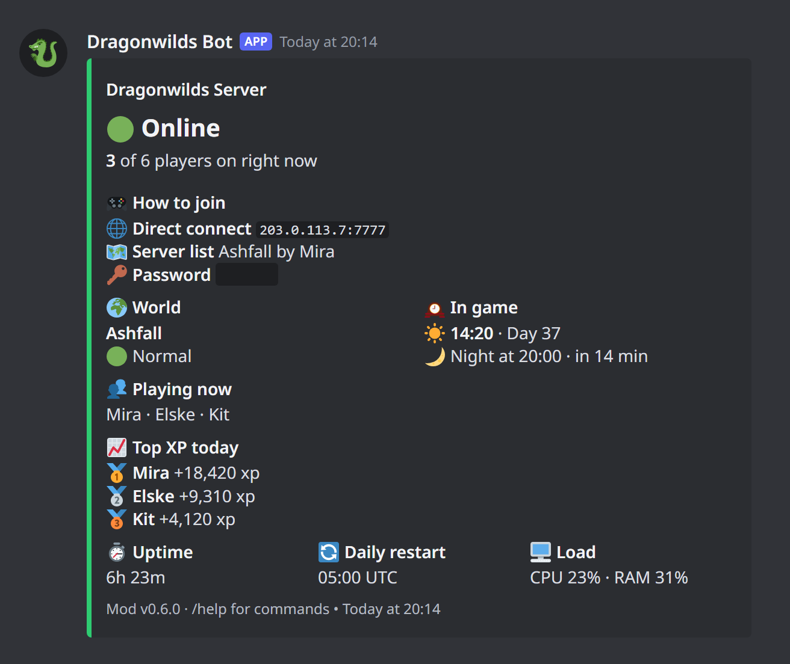
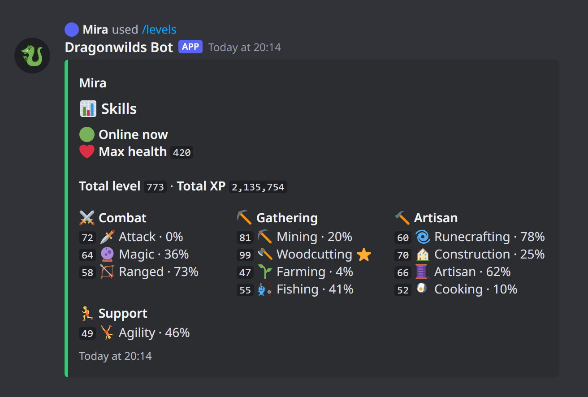

</div>

---

## ✨ Features

<table>
<tr>
<td width="50%" valign="top">

### 🎮 In Discord

- **`/levels`, `/level`** - any player's skills, live or from the last time they were seen
- **`/leaderboard`** - by total level, any skill or quests done, 🥇🥈🥉
- **`/me`** - everything about your own character: skills, quests, journal, playtime
- **`/quests`** - quests done and in progress · **`/perks`** - active skill perks
- **🔗 One-click account linking** - press a button, type a short code in game
- **`/gains`** - who gained the most XP today, this week or this month
- **`/playtime`, `/deaths`** - most played, most deaths
- **`/status`, `/online`, `/system`** - server, players and VPS load
- **`/item`** - any item with its wiki summary, picture and stats
- Player and skill names **auto-fill** as you type

</td>
<td width="50%" valign="top">

### 💬 Live in your channels

- **Two-way chat** - game chat in Discord, Discord messages in game
- **Level-ups** 🎉 and ⭐ 99 celebrations
- **Joins, leaves and deaths**, with the cause when the game gives one
- **Server notices** - online, offline, restarting, backups
- **Raid and hunt alerts** ⚔️ - pings the linked players it concerns
- **Weekly recap** every Sunday: top gainers, new 99s, most played
- **Live status board** - one self-updating message with how to join, who's on, the world and the in-game clock
- **Game update watcher** - warns when Steam has a new server build, then backs up, updates and restarts by itself
- The bot's status shows `🟢 3/16 players online`

</td>
</tr>
<tr>
<td width="50%" valign="top">

### 🛡️ For admins

- **`/server`** start, stop, restart (with player warnings), back up, list and restore backups
- **`/admin`** kick, ban, unban, give items, announce
- **Leaderboard cleanup** - remove a player and their stats
- **Private alerts** for crashes, high CPU / RAM / disk, and mod problems after a game update
- **AFK kick** with a warning first, optionally only when the server is full
- In-game `/kick`, `/ban`, `/give` for the game's own admins

</td>
<td width="50%" valign="top">

### ⚙️ Under the hood

- **REST API** and optional **Source RCON**, each with its own auth, IP whitelist and rate limits
- **Self-checking** - every offset is validated at runtime, and `/api/diagnostics` reports
  what a game update broke instead of serving nonsense
- **Saves the world before every backup**, so a backup is never a half-written file
- **Events pushed the moment they happen** - chat, joins and deaths reach Discord instantly
- **Bans that survive restarts**, offline players by SteamID64
- **One-command updates** from your PC - the bot updates without touching the server

</td>
</tr>
</table>

---

## 📸 Screenshots

<table>
<tr>
<td width="50%" valign="top">

**🏆 Leaderboards** · by total level, any skill or quests, online players marked

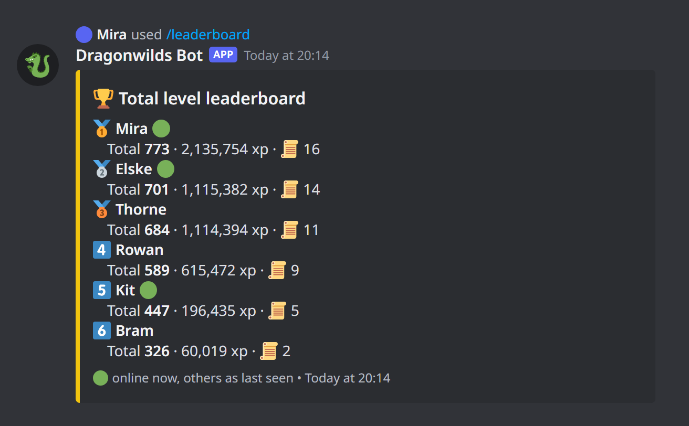

</td>
<td width="50%" valign="top">

**🎉 Live activity** · joins, leaves, AFK kicks, level-ups and 99s as they happen

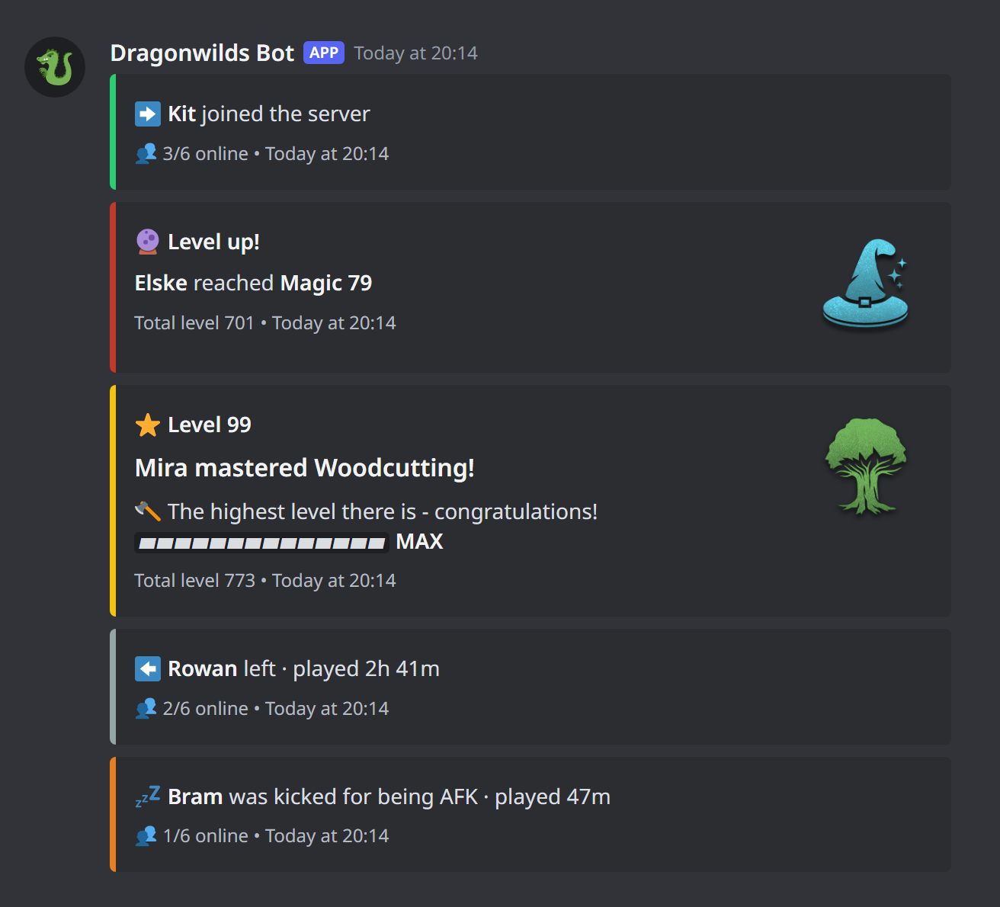

</td>
</tr>
<tr>
<td width="50%" valign="top">

**📊 One skill up close** · progress to the next level and XP left

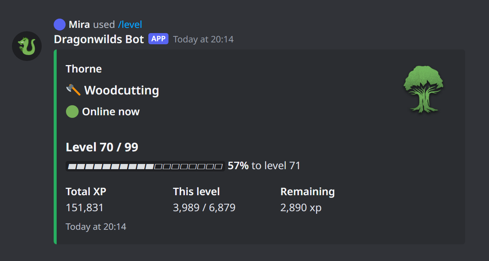

</td>
<td width="50%" valign="top">

**⏱️ Playtime and gains** · who played most, who gained most

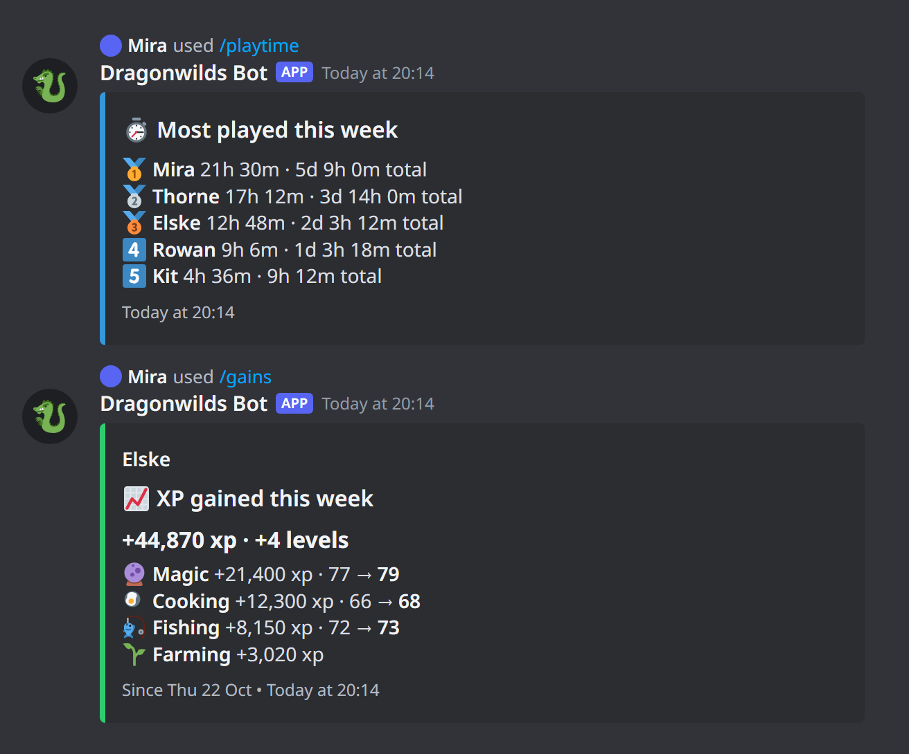

</td>
</tr>
<tr>
<td width="50%" valign="top">

**📅 Weekly recap** · every Sunday evening

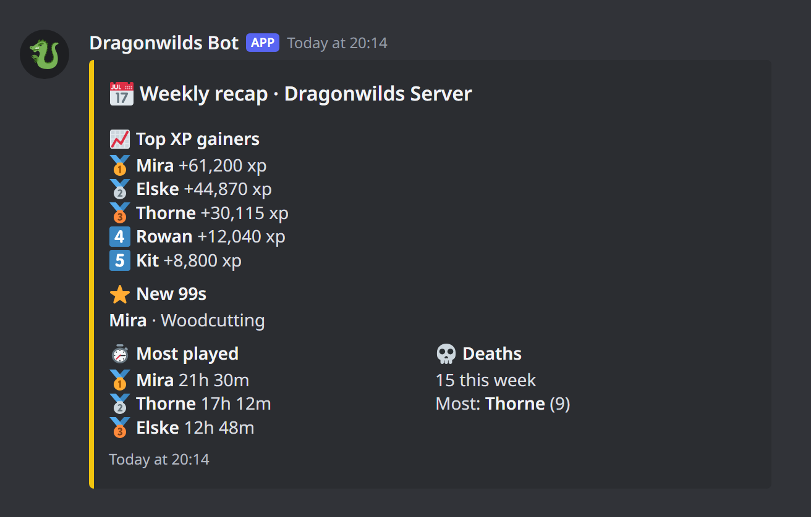

</td>
<td width="50%" valign="top">

**🎒 Item lookup** · straight from the wiki

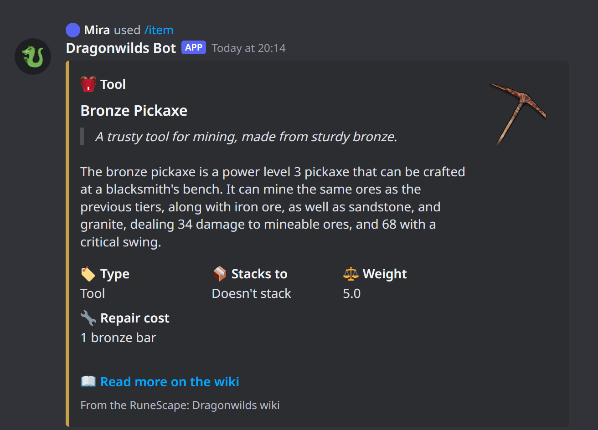

</td>
</tr>
<tr>
<td width="50%" valign="top">

**🙋 `/me`** · your linked character: skills, quests, journal, playtime

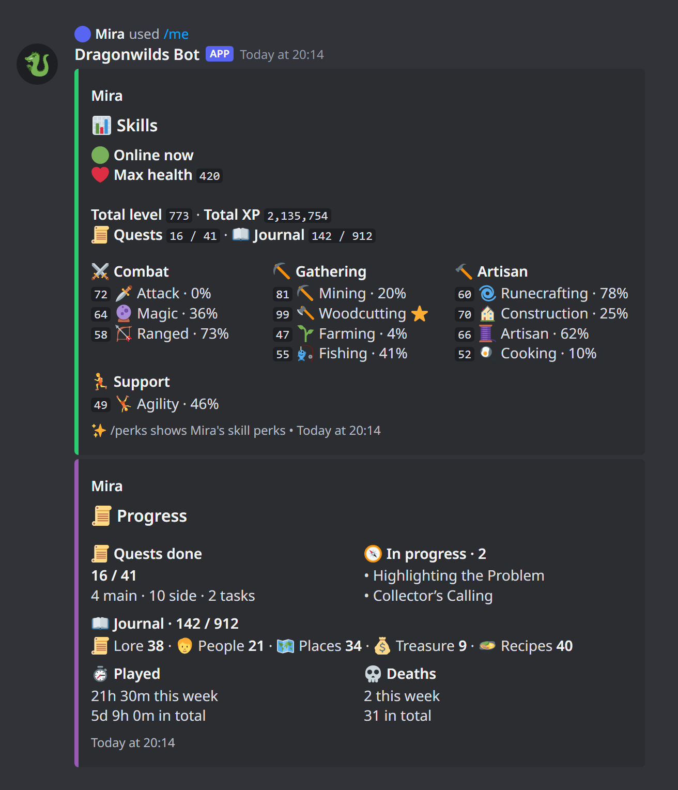

</td>
<td width="50%" valign="top">

**🔗 One-click linking** · a button, a short code typed in game, done

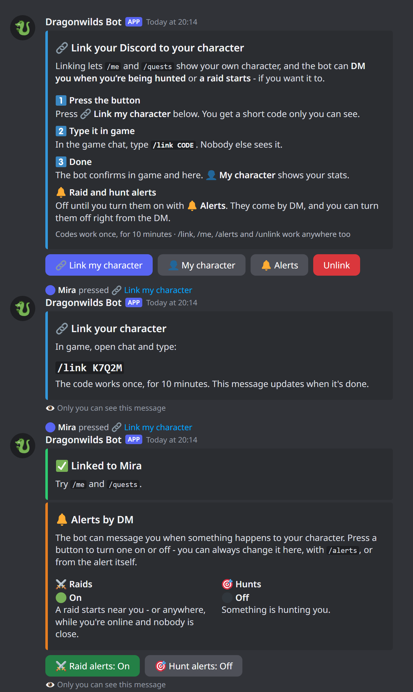

</td>
</tr>
<tr>
<td width="50%" valign="top">

**⚔️ Raid and hunt alerts** · ping the linked players they concern

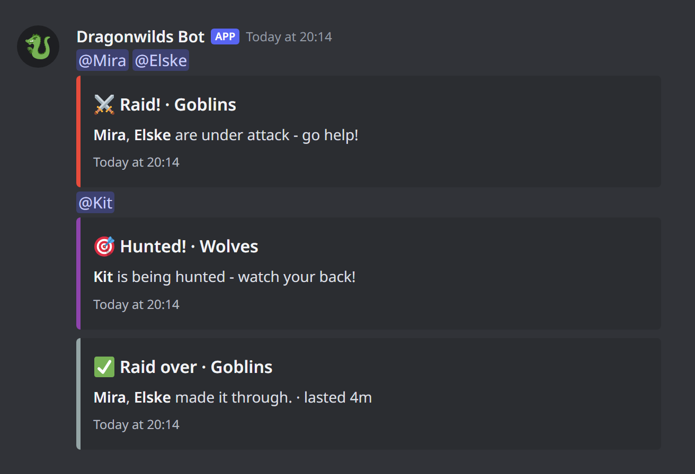

</td>
<td width="50%" valign="top">

**📜 Quests and ✨ perks** · each player's quests, a quest leaderboard and skill perks

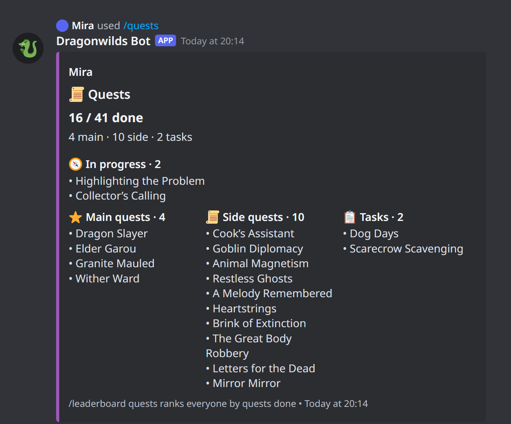
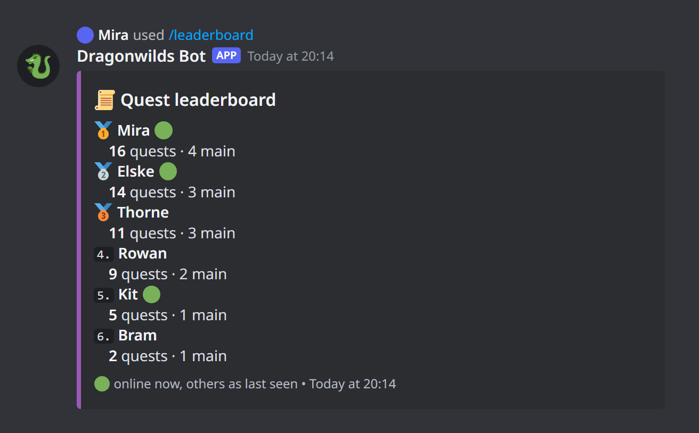
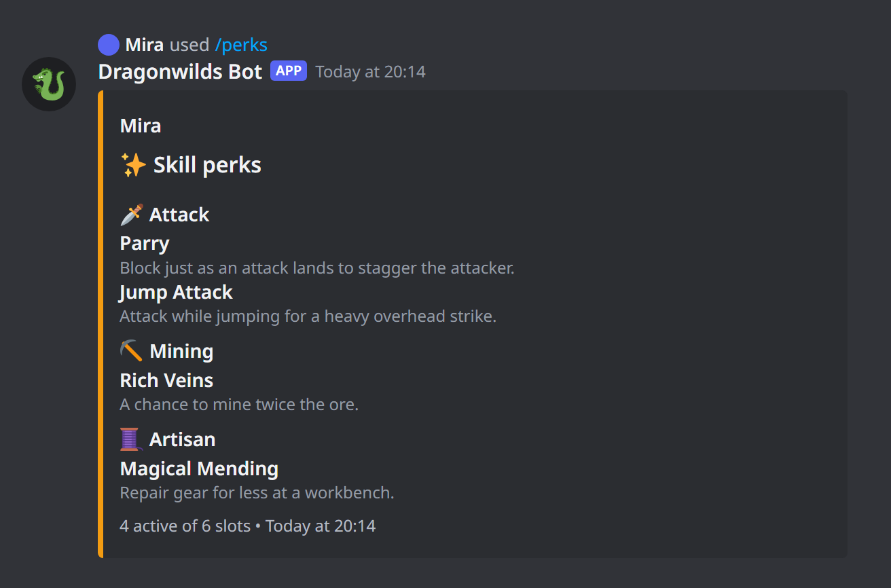

</td>
</tr>
<tr>
<td width="50%" valign="top">

**🔄 Server notices** · players warned before restarts, told when it's back

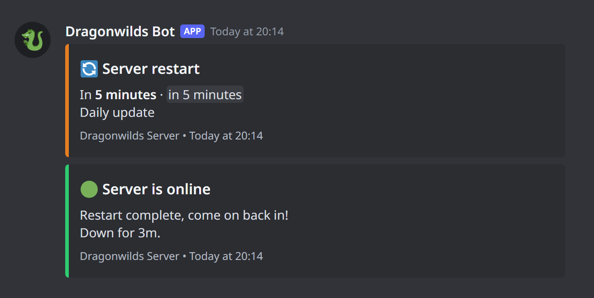

</td>
<td width="50%" valign="top">

**📖 Every command** · in `/help`, pinned in your chat channel

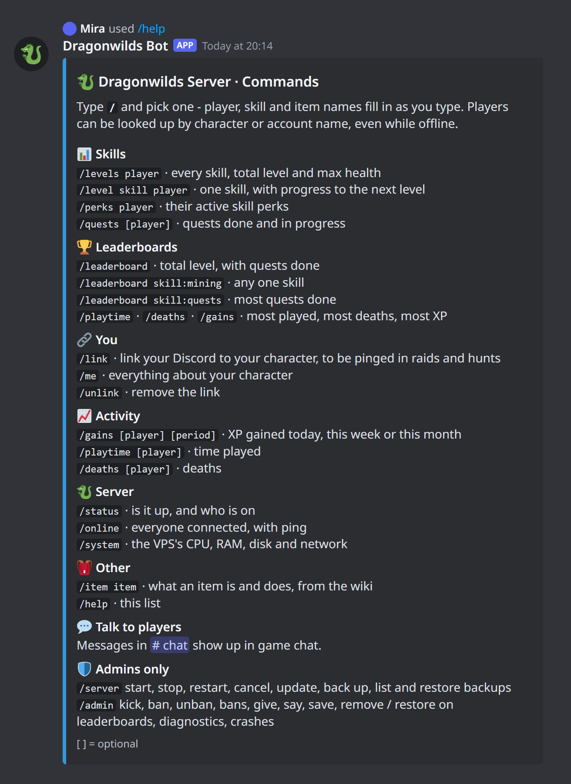

</td>
</tr>
</table>

<sub>Sample players. Rendered from the bot's own embed code by <a href="bot/docs/screenshots/generate.mjs"><code>bot/docs/screenshots/generate.mjs</code></a>, so they stay true to what the bot posts.</sub>

---

## 🧭 How it works

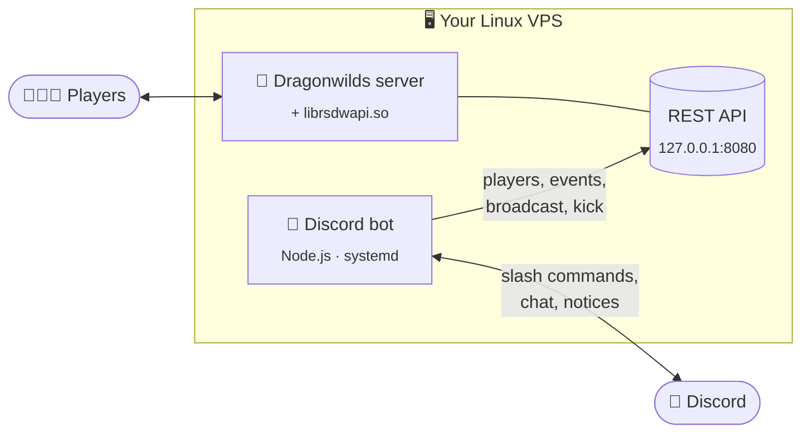

| Part | What it is |
| ---- | ---------- |
| **The mod** · `librsdwapi.so` | Loaded into the game server with `LD_PRELOAD`. Reads players straight from the game's memory and serves them over a local REST API, plus a chat, death, join and leave feed. |
| **The bot** · [`bot/`](bot/) | Runs next to the server as its own service and talks to the API. Keeps running when the server is down, and keeps everyone's last known stats. |

Updating the bot never needs a server restart. A new mod build is picked up at the next server start.

---

## 🚀 Quick start

> [!TIP]
> The step-by-step guide for a plain Steam install on a VPS - Discord setup, building,
> installing, systemd, cron and updating - is in **[DEPLOY.md](DEPLOY.md)**.

#### 📋 You need

| | |
| - | - |
| 🐧 **A Linux server** running the Dragonwilds dedicated server (a manual Steam install is fine; tested on Ubuntu) | 🛠️ `build-essential` to build the mod |
| 🟢 **Node.js 18.17+** for the bot | 🤖 **A Discord application** with a bot token and *Message Content Intent* on |

**1. Build the mod** on the server's machine:

```bash
sudo apt install -y build-essential
make -j"$(nproc)"          # → dist/librsdwapi.so
```

**2. Start the server with it:**

```bash
LD_PRELOAD=/home/dragonwilds/rs_server/librsdwapi.so ./RSDragonwildsServer.sh -log -port=7777
```

**3. Run the bot:**

```bash
cd bot && npm install --omit=dev
cp .env.example .env && nano .env   # Discord token, API token, channel IDs
npm start
```

**4. Update later** with one command from a Windows PC (put `user@your-vps` in `deploy\vps.txt` first):

```powershell
.\deploy\upload.ps1 -Bot -Mod      # add -Restart to load the new mod straight away
```

---

## 🧪 Compatibility

Built against the Dragonwilds **Patch 1.0** Linux dedicated server. The mod reads the game's
memory, so a game update can move things it depends on. When that happens it says so instead of
guessing: affected endpoints answer `503`, the log names what failed, `/api/diagnostics` (and the
bot's private alert to admins) lists the broken checks, and some lookups fall back to scanning
for where things moved. The bot keeps working with saved data either way.

## 🔐 Security

- Keep the API on `BindAddress=127.0.0.1` when the bot runs on the same machine - nothing else
  needs to reach it.
- Never commit `bot/.env` or `rsdwapi/settings.ini`: they hold the Discord token, the API bearer
  token and the RCON password. Both are git-ignored or outside the repository.
- Admin commands only answer the Discord user IDs in `ADMIN_USER_IDS`, and the bot can only
  start, stop and restart the game service through the narrow sudoers rule in DEPLOY.md.
- If a token leaks, replace it: reset the Discord token in the Developer Portal; for the API, put
  a new long random `BearerToken` (and `Password` for RCON) in `settings.ini` while the server is
  stopped, and the same token in the bot's `API_TOKEN`. Clearing `BearerToken` turns authentication
  off rather than making a new one.

---

## 🔧 Mod details

<details>
<summary><b>Build</b></summary>

<br/>

On the Linux machine that runs the server:

```bash
sudo apt install -y build-essential
make -j"$(nproc)"
```

Output: `dist/librsdwapi.so`. `libstdc++` and `libgcc` are linked statically, and building on the
server's own machine means the result never needs a newer glibc than it has. `make clean`
removes the build output.

</details>

<details>
<summary><b>Install</b></summary>

<br/>

Put `librsdwapi.so` beside the server and prefix whatever starts it with `LD_PRELOAD`:

```bash
LD_PRELOAD=/home/dragonwilds/rs_server/librsdwapi.so ./RSDragonwildsServer.sh -log -port=7777
```

or, starting the binary directly:

```bash
LD_PRELOAD=./librsdwapi.so ./RSDragonwilds/Binaries/Linux/RSDragonwildsServer-Linux-Shipping -log -port=7777
```

`LD_PRELOAD` is inherited by every process the launch command starts, including a wrapper
script's shell and the small commands it runs. The mod stays inert in all of them and only
starts inside the server itself. If it ever fails to recognise the server (no `loaded` line in
the log), add `RSDWAPI_FORCE=1` next to `LD_PRELOAD`.

> [!WARNING]
> Never copy a new build straight over the `librsdwapi.so` a running server has loaded - that
> can crash it. Copy it beside it and rename it over, which is what `deploy/update-mod.sh` does.

</details>

<details>
<summary><b>Configuration</b> · <code>rsdwapi/settings.ini</code></summary>

<br/>

On first run the mod writes `rsdwapi/settings.ini` beside the server binary. Set `RSDWAPI_DIR`
to put it somewhere else. The log prints the folder it uses (`RSDWRestAPI: data directory ...`).

A bearer token and an RCON password are generated on that first run and never regenerated
afterwards, so an empty value stays empty.

**The REST API is on by default. RCON is off by default** - set `Enabled=true` under `[RCON]` to
use it; the password is already generated and waiting.

```ini
[General]
EnableLogging=true
VerboseLogging=true

[API]
Enabled=true
BindAddress=0.0.0.0
Port=8080
BearerToken=<generated>
IPWhitelist=

[RCON]
Enabled=false
BindAddress=0.0.0.0
Port=27020
Password=<generated>
IPWhitelist=
CommandsPerMinute=60
CommandBurst=15
MaxFailedAuth=5
FailWindowSeconds=60
BanSeconds=300
MaxConnections=16

[AFK]
KickMinutes=0
WarnMinutes=1
OnlyWhenFull=false
MaxPlayers=0
ExemptAdmins=true
```

> [!IMPORTANT]
> When the bot runs on the same machine, set `BindAddress=127.0.0.1` so the API isn't
> reachable from the internet at all.

- Bans are kept in `rsdwapi/bans.json` beside the config and survive restarts.
- `IPWhitelist` takes a comma separated list of addresses and CIDR blocks
  (`127.0.0.1,10.0.0.0/8`). Empty allows everyone. It applies to both listeners independently,
  and an unparseable entry is logged and ignored rather than silently locking everyone out.
- Clearing `BearerToken` disables REST authentication entirely. That is deliberate and it
  sticks, but bind to `127.0.0.1` or set an `IPWhitelist` if you do it. A warning is logged at
  startup either way.
- An empty RCON `Password` keeps RCON from starting at all, by design.
- **AFK kick** is off until `KickMinutes` is set. Players who haven't moved or looked around get a
  private warning `WarnMinutes` before, and can rejoin straight away after the kick.
  `OnlyWhenFull=true` (with `MaxPlayers`) only kicks when someone else could use the slot, and the
  game's own admins are never kicked unless `ExemptAdmins=false`.

</details>

<details>
<summary><b>Logs</b></summary>

<br/>

`<data dir>/logs/api.log`, rotated on each boot with ten kept, and mirrored to the server's
stdout. It records startup and engine discovery, kicks, bans, joins, leaves and deaths, and with
`VerboseLogging=true` every API request and every chat line. The bot's frequent `/api/events`
polls are only logged when they fail.

</details>

---

## 📡 REST API

Every request needs `Authorization: Bearer <token>` unless `BearerToken` is empty.

| Method | Path | |
| :----: | ---- | - |
| `GET` | `/api/health` | Mod status and uptime |
| `GET` | `/api/players` | Every connected player, with stats, quests, journal and perks |
| `GET` | `/api/world` | World name and settings, the in-game clock, running raids and hunts |
| `GET` | `/api/events` | Chat, death, join, leave, AFK and link feed - `?wait=` to be told the moment something happens |
| `GET` | `/api/diagnostics` | Self-check of everything the mod reads |
| `POST` | `/api/save` | Make the game save the world |
| `GET` | `/api/save/candidates` | Functions that might be the game's world save |
| `POST` | `/api/kick` | Disconnect a player |
| `POST` | `/api/broadcast` | Message every player, or one with `to` |
| `POST` | `/api/give` | Give an item to a player |
| `GET` | `/api/items` | Loaded items, `?search=` to filter |
| `POST` | `/api/ban` · `/api/unban` | Ban or unban a player |
| `GET` | `/api/bans` | List bans |
| `GET` | `/api/hello` | Load check |

<details>
<summary><code>GET /api/players</code></summary>

<br/>

Accepts `?name=`, `?characterName=`, `?netId=` and `?characterGuid=` to narrow the list.

```bash
curl -H "Authorization: Bearer TOKEN" http://localhost:8080/api/players
```

```json
{
  "count": 1,
  "players": [{
    "name": "ExamplePlayer",
    "characterName": "Adventurer",
    "playerId": 256,
    "uniqueNetId": "76561190000000000",
    "uniqueNetIdSource": "net-id-string",
    "characterGuid": "00000000000000000000000000000000",
    "platform": "WIN",
    "pingMs": 60,
    "score": 0.0,
    "startTime": 80,
    "isSpectator": false, "isBot": false, "isInactive": false,
    "spawned": true,
    "pawnClass": "BP_PlayerCharacter_C",
    "color": { "hex": "D47247FF", "r": 0.658, "g": 0.168, "b": 0.063, "a": 1.0 },
    "location": { "x": 10360.0, "y": 186410.0, "z": -3070.0 },
    "rotation": { "pitch": 0.0, "yaw": 128.2, "roll": 0.0 },
    "velocity": { "x": 0.0, "y": 0.0, "z": 0.0 },
    "movementMode": 1,
    "health":     { "current": 100.0, "max": 100.0, "canDie": true, "isDead": false },
    "sustenance": { "current": 72.0, "max": 100.0 },
    "hydration":  { "current": 65.0, "max": 100.0 },
    "attributes": [{ "name": "Health", "value": 100.0, "baseValue": 100.0, "shared": false }],
    "skills":     [{ "skill": "SKILL_Woodcutting", "currentXP": 4210 }],
    "quests":     [{ "id": "Quest_CooksAssistant", "name": "Cook's Assistant", "kind": "side", "complete": true, "objective": "" }],
    "journal":    { "total": 142, "kinds": { "lore": 38, "people": 21, "places": 34 } },
    "perks":      { "max": 6, "active": [{ "id": "PerkV2_Attack_Parry", "name": "Parry", "description": "...", "skill": "SKILL_Attack" }] },
    "pointers": { "playerState": "0x...", "pawn": "0x...", "controller": "0x..." }
  }]
}
```

Skills are reported as raw XP; the bot converts XP to levels with the Dragonwilds XP table.
`quests` lists every quest started or done (`kind` is `main`, `side` or `task`), `journal`
counts unlocked journal entries by kind, and `perks` lists the active skill perks. Each is
`null` until the player has fully loaded in.
Health and max health come from the character's attributes component, not from
`UHealthComponent`'s own fields - on a player those are always zero, because
`UPlayerHealthComponent` sources both from attributes.

</details>

<details>
<summary><code>GET /api/events</code></summary>

<br/>

In-game chat, player deaths, joins, leaves and AFK kicks, oldest first. Pass the last `id` you have
seen as `?since=` to get only newer events; `?limit=` caps the count (default 100, max 500). The
last 500 events are kept in memory. With `?wait=N` (up to 25) the request is held open until an
event arrives or N seconds pass, so a reader hears about it at once instead of polling.

```json
{
  "bootId": 1793042710123,
  "latestId": 43,
  "events": [
    { "id": 41, "time": 1793042790000, "type": "chat", "name": "Adventurer", "netId": "7656...",
      "characterGuid": "...", "playerId": 256, "message": "hello", "location": "" },
    { "id": 42, "time": 1793042795000, "type": "death", "name": "Adventurer", "netId": "7656...",
      "characterGuid": "", "playerId": 0, "message": "", "location": "10360, 186410, -3070",
      "cause": "", "players": -1 },
    { "id": 43, "time": 1793042799000, "type": "join", "name": "Adventurer", "netId": "7656...",
      "characterGuid": "", "playerId": 0, "message": "", "location": "", "cause": "", "players": 3 }
  ]
}
```

`cause` on a death is the game's own event tag when the death came from one (empty when it was
spotted from the player's health). `players` on a join or leave is how many are online after it.
Ids restart at 1 when the server restarts; `bootId` changes at the same time, so a reader knows
to start over from `since=0`.

</details>

<details>
<summary><code>GET /api/diagnostics</code></summary>

<br/>

A self-check of what the mod reads from the game, so a game update that moves something shows up
here instead of a feature quietly doing nothing. Each check has `ok` `true`, `false`, or `null`
when it can't be checked yet (most need someone online). The bot messages its admins when a
check starts failing.

```json
{
  "version": "0.3.0",
  "checks": [
    { "name": "engine", "ok": true, "detail": "141532 objects" },
    { "name": "chatComponent", "ok": true, "detail": "at controller +0x12A0 (moved from the SDK's +0x1288, found by scanning)" },
    { "name": "playerSkills", "ok": null, "detail": "checked once someone is online" }
  ]
}
```

</details>

<details>
<summary><code>POST /api/save</code> · <code>GET /api/save/candidates</code></summary>

<br/>

Makes the game save the world - the bot calls it before every backup, so the copy is a finished
save rather than one the game is halfway through writing.

The game's save function has no fixed name, so it's chosen once per game version.
`GET /api/save/candidates` lists every zero-argument function with "save" in its name on a
world-level class; `POST /api/save` calls one on the live object, on the game thread:

```bash
curl -X POST http://localhost:8080/api/save -H "Authorization: Bearer TOKEN" -H "Content-Type: application/json" -d "{\"function\":\"SomeGameMode.SaveWorld\"}"
```

Only functions without parameters are called. A successful call only proves the function ran -
the bot's `/admin save` also checks that the `.sav` files changed, which is how you find the right one.

</details>

<details>
<summary><code>POST /api/kick</code></summary>

<br/>

`player` accepts a SteamID64, player id, character GUID, character name or display name, matched
in that order, most stable first.

```bash
curl -X POST http://localhost:8080/api/kick -H "Authorization: Bearer TOKEN" -H "Content-Type: application/json" -d "{\"player\":\"76561190000000000\",\"reason\":\"Kicked by an administrator\"}"
```

A kick holds until the server restarts. The kicked player is remembered and removed again if
they reconnect.

</details>

<details>
<summary><code>POST /api/broadcast</code></summary>

<br/>

Sends a line to every connected player's chat box.

```bash
curl -X POST http://localhost:8080/api/broadcast -H "Authorization: Bearer TOKEN" -H "Content-Type: application/json" -d "{\"message\":\"Restarting in 5 minutes\"}"
```

`sender` is optional and defaults to `Server`, giving `[Server] Restarting in 5 minutes`. The
game has no server identity in chat, so a broadcast is delivered under the receiving player's
own name: everyone sees the `[Server]` prefix, but it looks as though they sent it themselves.
After a server restart, broadcasts work once the first player has joined.

With `"to"` (a net id, character GUID or name) the line goes to that one player only, and
answers 404 if they aren't connected.

</details>

<details>
<summary><code>GET /api/world</code></summary>

<br/>

```json
{
  "worldName": "WorldOne", "host": "", "difficulty": "normal", "hardcore": "off",
  "time": { "day": 37, "hour": 14.33, "dawn": 6.0, "dusk": 20.0, "isDay": true, "paused": false, "minutesPerDay": 60 },
  "events": [{ "id": "81234-7f...", "type": "raid", "name": "BP_RaidEvent_Goblins_C",
              "location": { "x": 10360.0, "y": 186410.0, "z": -3070.0 }, "radius": 3000.0 }]
}
```

`difficulty` is `normal`, `hard`, `creative` or `custom`; `hardcore` is `off`, `active`,
`failed` or `succeeded`. `time` is `null` until a player has joined since the server started.
`events` lists raids and hunted events while they run; `id` stays the same for as long as one does.

</details>

<details>
<summary><code>POST /api/give</code></summary>

<br/>

```bash
curl -X POST http://localhost:8080/api/give -H "Authorization: Bearer TOKEN" -H "Content-Type: application/json" -d "{\"player\":\"76561190000000000\",\"item\":\"IronBar\",\"count\":10}"
```

`item` matches the full asset name (`ITEM_Resources_IronBar`), the name without the `ITEM_`
prefix, or a unique partial like `ironbar`. Only items currently loaded on the server can be
given; `GET /api/items` shows what is available right now. `count` defaults to 1.

</details>

<details>
<summary><code>POST /api/ban</code> · <code>POST /api/unban</code></summary>

<br/>

```bash
curl -X POST http://localhost:8080/api/ban -H "Authorization: Bearer TOKEN" -H "Content-Type: application/json" -d "{\"player\":\"76561190000000000\",\"reason\":\"Griefing\"}"
```

Kicks the player if online and adds them to `bans.json`. They are removed again whenever they
reconnect. Offline players can be banned by SteamID64. `POST /api/unban` takes the same `player`
field.

</details>

<details>
<summary><code>GET /api/health</code></summary>

<br/>

Deliberately minimal, because authentication can be turned off and this therefore has to be safe
to serve to anyone. No ports, no owner id, no server GUID, no memory addresses.

```json
{"status":"healthy","version":"0.5.0","uptimeSeconds":41.2,"engineReady":true}
```

`status` is `starting` until the world has loaded. Engine discovery detail goes to the log at
startup and to the authenticated RCON `status` command.

</details>

---

## 🖥️ RCON

Standard Valve Source RCON, so `mcrcon`, `rcon-cli` and panel consoles all work. Off by default.

```bash
mcrcon -H 127.0.0.1 -P 27020 -p PASSWORD players
```

<details>
<summary><b>Commands and rate limits</b></summary>

<br/>

| Command | |
| ------- | - |
| `help` | List commands |
| `health` | Mod and engine readiness in one line |
| `status` | Server identity, world and engine discovery |
| `players [json]` | Player table, or the API payload |
| `playercount` | Number of connected players |
| `player <name>` | Everything known about one player, as JSON |
| `kick <player> [reason]` | Disconnect a player |
| `broadcast <message>` | Send a message to every player |
| `give <player> <item> [count]` | Give an item to a player |
| `items [search]` | List loaded items |
| `ban <player> [reason]` | Ban a player, offline players by SteamID64 |
| `unban <player or SteamID64>` | Remove a ban |
| `bans` | List bans |

Rate limiting is a per-address token bucket: `CommandsPerMinute` is the sustained rate,
`CommandBurst` is how much can be spent at once. Separately, `MaxFailedAuth` failed logins inside
`FailWindowSeconds` refuse that address for `BanSeconds`, enforced at `accept` before the
password is read.

</details>

---

## ⌨️ In-game commands

For the game's own admins - anyone who has entered the admin password in the **Server
Management** screen. Replies go only to the sender, and the command itself is never shown to
other players.

| Command | |
| ------- | - |
| `/kick <player> [reason]` | Disconnect a player |
| `/ban <player> [reason]` | Ban a player |
| `/unban <player or SteamID64>` | Remove a ban |
| `/give <player> <item> [count]` | Give an item to a player |
| `/help` | List commands |

For everyone:

| Command | |
| ------- | - |
| `/link <code>` | Link to a Discord account, with the code from the bot's `/link`. Never shown in chat |

---

## 📚 SDK

The engine layer is driven by a Dumper-7 dump of the server binary, which is not included in this
repository. Every offset the mod uses carries a `// Source:` comment naming the file it came from,
so they can be re-verified against a fresh dump after a game patch - and `/api/diagnostics`
tells you when that's needed.

## 🤝 Contributing

Issues and pull requests are welcome - especially after a game patch. If something stops
working, include the output of `/api/diagnostics` and the start of `rsdwapi/logs/api.log` (the
engine discovery lines), with tokens removed.

## 📄 License

Released under the MIT License - see [LICENSE](LICENSE).

The mod is based on [dkoz/RSDWServerAPI](https://github.com/dkoz/RSDWServerAPI) by Kozejin;
the Discord bot, event feed and the rest were added on top. Not affiliated with Jagex.
*RuneScape: Dragonwilds* is a trademark of Jagex Ltd. Provided as is, without warranty of any
kind - use it at your own risk.
