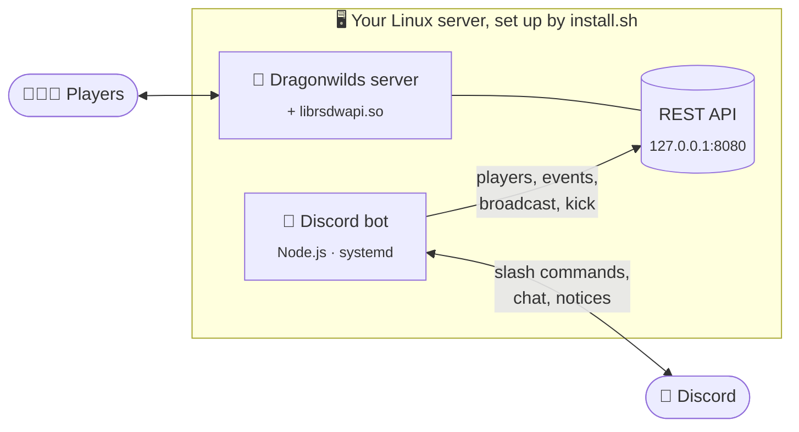

<div align="center">

# 🐉 RSDWServerAPI

### Your own _RuneScape: Dragonwilds_ server, with Discord built in, in one command.

**A deploy tool, a server mod and a Discord bot for Linux VPS and dedicated servers.**<br>
Answer a few questions and get a running server with live skills and leaderboards, two-way chat,
a 🐧 penguin hunt leaderboard, raid alerts, automatic backups and updates, and full control from Discord.


[](https://buymeacoffee.com/paradoxjs)

[**🚀 Quick start**](#-quick-start) · [**✨ Features**](#-features) · [**📸 Screenshots**](#-screenshots) · [**🤖 Bot**](bot/README.md) · [**🔧 Mod & API**](MOD.md) · [**🏢 For game hosts**](HOSTING.md) · [**💬 Help**](#-help-and-support)

</div>

> [!NOTE]
> **Players don't install anything.** Everything runs on the server, and people join as usual.
> (The optional longer chest range is the one exception, and the bot hands out a one-click installer for it.)

---

## 🚀 Quick start

Never set up a server before? This is for you. It takes about **15 minutes**, most of it waiting
for the game to download.

### 📋 What you need

| | |
| 🖥️ **A Linux server** | A VPS or dedicated server with **Ubuntu 22.04 or newer** or **Debian 12+**, 64-bit. The game wants **2 GB of RAM plus 1 GB per player**, so 8 GB for a full server of 6. About 20 GB of disk. |
| 💬 **A Discord server** | One where you can add bots (you own it or you're an admin). |
| 🎮 **Your Dragonwilds Player ID** | In the game: **Settings**, at the very bottom (there's a copy button). It makes you the server's owner. |

### 1️⃣ Make the Discord bot (2 minutes)

1. Open the [Discord Developer Portal](https://discord.com/developers/applications) and click **New Application**. Name it after your server.
2. Go to **Bot**, click **Reset Token** and copy the token somewhere safe. *It's a password: never share it.*
3. On the same page, turn on **Message Content Intent** and save.
4. In Discord: **User Settings → Advanced → Developer Mode** on. Then right-click your own name and **Copy User ID**.

You don't need to invite the bot yet: the installer gives you the link.

### 2️⃣ Connect to your server

Your host gives you an **IP address**, a **user** (often `root` or `ubuntu`) and a password or key.
On Windows open **Terminal** (or PowerShell); on a Mac open **Terminal**. Then:

```bash
ssh root@YOUR.SERVER.IP
```

Type `yes` if it asks about the fingerprint, then your password (it stays invisible while you type).

### 3️⃣ Run the installer

Paste this and press Enter:

```bash
curl -fsSLO https://raw.githubusercontent.com/joaopmsilva/RSDWServerAPI/main/install.sh && sudo bash install.sh
```

It checks your system, then asks:

| Question | What to put |
| -------- | ----------- |
| Your Dragonwilds Player ID | From the game, see above |
| Server name, world name | Anything you like. Players find the world by its **exact** name |
| World password | Enter for none, or a password to keep it private |
| Admin password | Press Enter to take the generated one, or pick your own |
| Port, max players | Press Enter for 7777 and 6 |
| Bot token | The token from step 1 (it's checked with Discord straight away) |
| Your Discord user ID | From step 1. This makes you an admin of the bot |
| Daily restart time | When to update and restart each day, like `05:00` |

Then it does everything else by itself: packages, Node.js, the game server (about 6 GB), the mod,
the bot, the services, hourly backups, the daily restart and the firewall.

### 4️⃣ Add the bot to Discord

At the end the installer prints an **invite link**. Open it, pick your Discord server and press
**Authorize**. The bot makes its own channels straight away:

```
📁 Your Server Name
   #server-info          how to join, who's on, server health (always up to date)
   #server-status        online / offline / restarts / backups
   #game-chat            talk to players in game from Discord
   #activity             level-ups, quests, the weekly recap
   #deaths               who died, and to what
   #bot-commands         use the bot here
   #link-your-character  players link their Discord to their character
```

and sends you a DM with the admin commands. Drag the category wherever you like.

### 5️⃣ Play

In the game: **Worlds → Public**, search your world name, join. To get admin in game, open
**Settings → Server Management** and enter the admin password (the installer keeps it in
`/etc/rsdw/install.env`).

> [!TIP]
> **Can't find the server?** Your host may have its own firewall in its control panel: allow
> **UDP 7777** there. Crossplay servers also show an **invite code** in `#server-info` for console players.

<details>
<summary><b>🔄 Updating, changing settings, and where everything lives</b></summary>

<br>

| To... | Do |
| ----- | -- |
| Update the bot and mod | Nothing: you get a DM with an **Update now** button when a release comes out. Or `/admin update` |
| Update the game | Automatic, every day at your restart time. Or `/server action:update` |
| Change your answers | `sudo bash install.sh --reconfigure` |
| Update everything by hand | `sudo bash install.sh` again (your world, settings and bot data are kept) |
| More bot settings | `sudo nano /home/dragonwilds/rsdw-bot/.env`, then `sudo systemctl restart rsdw-bot` (all explained in [CONFIG.md](bot/CONFIG.md)) |
| Restart the game server | `/server action:restart` in Discord, or `sudo systemctl restart dragonwilds` |
| Watch the bot's log | `sudo journalctl -u rsdw-bot -f` |

| What | Where |
| ---- | ----- |
| Game server | `/home/dragonwilds/rs_server` (service `dragonwilds`) |
| Game settings | `rs_server/RSDragonwilds/Saved/Config/LinuxServer/DedicatedServer.ini` |
| Mod and its settings | `rs_server/librsdwapi.so`, `rs_server/rsdwapi/settings.ini` |
| Discord bot | `/home/dragonwilds/rsdw-bot` (service `rsdw-bot`) |
| Backups | `/home/dragonwilds/backups` (hourly, newest 10 kept) |

Already run a server set up by hand? The installer picks up your existing settings, or follow the
manual [setup guide](DEPLOY.md).

</details>

---

## ✨ Features

<table>
<tr>
<td width="50%" valign="top">

### 🚀 One-command server

- **Installs everything**: system packages, Node.js, steamcmd, the game server, the mod and the bot
- **Detects your system**, checks RAM and disk, and runs as its own user, not root
- **Hourly backups** that save the world first, newest 10 kept
- **Daily update and restart**, with in-game and Discord warnings when people are on
- **Game updates** are spotted on Steam and installed by themselves
- **⬆️ Updates itself**: a DM with **Update now** when a new release is out
- **Re-run any time** to update or change answers; nothing is lost

</td>
<td width="50%" valign="top">

### 🎮 For players, in Discord

- **`/levels` `/perks` `/quests` `/kills`**: any player, live or from when they were last seen
- **`/leaderboard`**: total level, any skill, quests, kills, 🐧 penguins, with 🥇🥈🥉
- **`/me`**: your skills, quests, journal, playtime, kills, deaths and penguins
- **`/gains` `/playtime` `/deaths`**: today, this week, this month
- **`/status`** and **`/item`** (wiki summary, picture and stats)
- **🔗 One-click linking** of Discord to a character
- **⚔️ Raid and hunt alerts** by DM, for players who want them

</td>
</tr>
<tr>
<td width="50%" valign="top">

### 💬 Live in your channels

- **Channels made for you**, read-only where they should be
- **Two-way chat** between game and Discord
- **Live status board**: how to join (address, world, password, crossplay invite code), who's on, top XP today, server health
- **Deaths with the cause**, **level-ups** 🎉, **99s** ⭐ and **quests** 📜
- **Joins and leaves** with time played, **weekly recap** on Sundays
- **Server notices**: restarts, back online, backups, updates

</td>
<td width="50%" valign="top">

### 🛡️ For admins

- **`/server`**: start, stop, restart with warnings, update, back up, restore backups
- **`/admin`**: kick, ban, give items, announce, save, leaderboard cleanup
- **Private alerts**: crashes with a full report, high CPU / RAM / disk, a game update breaking something
- **🧳 Carry-over checks**: a DM when a character returns from another world with things it didn't get here (restart rollbacks are allowed for)
- **📈 `/admin performance`**: tick rate, stalls and their causes
- **AFK kick**, **longer chest range**, and in-game `/kick` `/ban` `/give`
- **`/admin contact`**: message the developer

</td>
</tr>
</table>

<details>
<summary><b>⚙️ Under the hood</b></summary>

<br>

- **Update-resistant**: the mod finds what it needs by name in the game's own type information, so a
  patch that moves things around rarely needs a new build
- **Self-checking**: `/api/diagnostics` says exactly what a game update broke instead of serving
  nonsense, and the bot DMs the admins about it
- **Light**: about **3% of one core**, reading memory instead of running code on the game thread
- **Instant events**: chat, joins, deaths, kills and penguins reach Discord as they happen
- **REST API** and optional **Source RCON**, each with auth, an IP whitelist and rate limits ([MOD.md](MOD.md))
- **Safe by default**: the API only listens on the machine itself, the bot can only start, stop and restart the game service, and admin commands only answer the IDs you gave
- **Bans that survive restarts**, offline players by SteamID64

</details>

### 🐧 The penguin hunt leaderboard

<table>
<tr>
<td width="52%" valign="top">

Patch 1.0.2 let **over 200 Killer Gentoo Penguins** loose across Ashenfall. Find one and it flees,
leaving a **Penguin Coin** for the shop in Bramblemead. They move every **7 in-game days**.

- 🏆 **`/leaderboard penguins`**: everyone ranked, with this week's haul
- 🙋 **`/me`**: your own count next to kills, deaths and playtime
- 🔁 **Fair**: each penguin counts once per character, however often it's reported
- 🕰️ **Catches up** on penguins found before the mod loaded

<sub>The mod reads each penguin's spawn slot and the characters that collected it every 10 seconds
while someone is online. Nothing is hooked on the game thread.</sub>

</td>
<td width="48%" valign="top">


</td>
</tr>
</table>

---

## 📸 Screenshots

<table>
<tr>
<td width="50%" valign="top">

**🏆 Leaderboards**: total level, any skill, quests, kills, penguins


</td>
<td width="50%" valign="top">

**📊 `/levels`**: every skill by category, with progress to the next level


</td>
</tr>
<tr>
<td width="50%" valign="top">

**💀 Deaths and 📜 quests**: what killed them, and every quest finished


</td>
<td width="50%" valign="top">

**🎉 Live activity**: joins, leaves, AFK kicks, level-ups and 99s as they happen


</td>
</tr>
<tr>
<td width="50%" valign="top">

**📜 `/quests`**: what's left, by region, and where to start next


</td>
<td width="50%" valign="top">

**⚔️ Kills**: the kill board, and each player's favourite prey


</td>
</tr>
<tr>
<td width="50%" valign="top">

**🧳 Carry-over alert** (admins only): who came back from another world richer


</td>
<td width="50%" valign="top">

**📈 `/admin performance`**: is the server keeping up, and if not, why


</td>
</tr>
<tr>
<td width="50%" valign="top">

**⚔️ Raid and hunt alerts**: by DM, for players who turn them on


</td>
<td width="50%" valign="top">

**🔗 One-click linking**: a button, a short code typed in game, done


</td>
</tr>
<tr>
<td width="50%" valign="top">

**⏱️ Playtime and gains**: who played most, who gained most


</td>
<td width="50%" valign="top">

**📅 Weekly recap**: every Sunday evening


</td>
</tr>
<tr>
<td width="50%" valign="top">

**📦 Longer chest range**: the how-to card, with the installer attached


</td>
<td width="50%" valign="top">

**🐉 `/status`** and **🎒 `/item`**: who's on, and any item from the wiki


</td>
</tr>
<tr>
<td width="50%" valign="top">

**🏅 Quest board** and **✨ `/perks`**


</td>
<td width="50%" valign="top">

**🔄 Server notices** and **📖 `/help`**


</td>
</tr>
</table>

<sub>Sample players. Rendered from the bot's own embed code by <a href="bot/docs/screenshots/generate.mjs"><code>bot/docs/screenshots/generate.mjs</code></a>, so they match what the bot posts.</sub>

---

## 🧭 How it works



| Part | What it is |
| ---- | ---------- |
| **The mod** · `librsdwapi.so` | Loaded into the game server with `LD_PRELOAD`. Reads players, quests, kills and penguins straight from the game's memory and serves them over a local REST API, plus a live event feed (chat, joins, leaves, deaths, kills, penguins). Details in [MOD.md](MOD.md). |
| **The bot** · [`bot/`](bot/) | Runs next to the server as its own service and talks to the API. Keeps running while the server is down, and remembers everyone's last known stats. |
| **The installer** · [`install.sh`](install.sh) | Sets up the machine, the game, the mod and the bot, and the services, backups and daily restart that keep them running. Run it again to update. |

Updating the bot never needs a server restart. A new mod build loads at the next server start.

---

## 🏢 For game hosts

Run a game server hosting company? The mod is one file loaded with `LD_PRELOAD`, and the bot is a
small Node.js app, so both fit panel-based hosting (Pterodactyl, Pelican and others).
**[HOSTING.md](HOSTING.md)** explains how to offer it, and I'm happy to help set it up.

---

## 💬 Help and support

- **Questions, bugs, ideas**: message me on Discord, **[joaosilvajs](https://discord.com/users/169180385501118485)** (my DMs are open), or run `/admin contact` in your server
- **Bug reports**: [GitHub issues](https://github.com/joaopmsilva/RSDWServerAPI/issues). Include your versions (`/admin update` shows them) and, for a crash, the newest file in the bot's `data/crashes/`
- **After a game patch** something may stop working until the next release: `/admin diagnostics` shows what

<div align="center">

<br>

**Enjoying it? A coffee keeps the updates coming.**

<a href="https://buymeacoffee.com/paradoxjs"></a>

</div>

---

## 📚 More

| | |
| - | - |
| [**bot/README.md**](bot/README.md) | Everything the Discord bot does, command by command |
| [**bot/CONFIG.md**](bot/CONFIG.md) | Every bot setting |
| [**MOD.md**](MOD.md) | The mod: settings, REST API, RCON, in-game commands |
| [**DEPLOY.md**](DEPLOY.md) | Setting it all up by hand, and the developer's update scripts |
| [**HOSTING.md**](HOSTING.md) | For game server hosts |

## 🤝 Contributing

Issues and pull requests are welcome, especially after a game patch. If something stops working,
include the output of `/api/diagnostics` and the start of `rsdwapi/logs/api.log` (the engine
discovery lines), with tokens removed.

## 📄 License

Released under the MIT License, see [LICENSE](LICENSE).

The mod is based on [dkoz/RSDWServerAPI](https://github.com/dkoz/RSDWServerAPI) by Kozejin; the
installer, the Discord bot, the event feed and the rest were added on top. Not affiliated with
Jagex. *RuneScape: Dragonwilds* is a trademark of Jagex Ltd. Provided as is, without warranty of
any kind; use it at your own risk.
